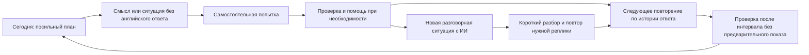

# Продукт: от знакомого слова к самостоятельной речи

## Пользовательская задача

«Я узнаю слово, когда вижу или слышу его, но не могу вспомнить в нужный момент». Основной пользователь — русскоязычный изучающий английский, которому нужны знакомые темы и практика активной лексики. A2–B1 используется как иллюстративный уровень в концептах; при входе уровень, цели и сложность настраиваются.

Основной цикл:

Разговор продолжает работу с лексикой. Система выбирает несколько подходящих слов и создаёт естественный контекст для их употребления. Свободная беседа также доступна; она не заменяет проверку конкретных слов.

## Что перенято из официальной документации продуктов

| Источник | Полезный принцип | Решение для Recall |
|---|---|---|
| [Speak](https://www.speak.com/) и его справка | Learn → Practice → Apply, уроки по ошибкам, Retry | Один цикл карточек и речи; затруднения возвращаются в дальнейшую практику. |
| [Duolingo Video Call](https://blog.duolingo.com/video-call/) | Короткий разговор, transcript после завершения | Понятная ситуация, помощь по запросу и спокойный разбор после беседы. |
| [Anki FSRS](https://docs.ankiweb.net/manual/deck-options) | Интервалы и корректный смысл Again / Hard | Отделять забывание от успешного ответа с усилием; управлять нагрузкой. |
| [ELSA Speech Analyzer](https://elsaspeak.com/en/speech-analyzer) | Разные компоненты речевого результата | Знание слова, уместность и произношение не сводятся в один балл. |
| [Memrise](https://explore.memrise.com/help) | Звучание, контекст и несколько видов деятельности | Аудиообразец и пример у слова, разные показатели учебного результата. |
| [Quizlet Learn](https://quizlet.com/features/learn) | Разные режимы из одного набора, web/mobile | Одна лексическая база, отдельные задания и расписания; синхронизация. |

Подробнее: [PRODUCTS.md](research/PRODUCTS.md). Это анализ публичной документации известных продуктов, не измеренный рейтинг популярности и не тестирование всех платных функций после авторизации.

## Как учтены все 13 подробно разобранных источников научной базы

Идентификаторы относятся к [EVIDENCE.md](../knowledge-base/vocabulary-learning/EVIDENCE.md).

| Источник | Принцип или граница результата | Проектное решение |
|---|---|---|
| R001 — метаанализ распределённой практики | Возвращение в разные дни, зависимость эффекта от условий | Очередь повторений с адаптацией; отсутствие «магического» фиксированного расписания. |
| R002 — обзор spacing/retrieval | Активное извлечение; ощущение знакомости не равно сохранению | Ответ скрыт до попытки. Проверка спустя время отделена от количества просмотров. |
| R003 — метаанализ интервалов извлечения | Нет общего превосходства увеличивающихся интервалов | FSRS выбран как инженерный инструмент, а не как доказанный этими работами единственный лучший алгоритм. |
| R004 — перенос обучения | Перенос зависит от условий | Новые речевые ситуации, вариативные подсказки, отдельный учёт применения. |
| R005 — трудность и извлечение | Попытка вспомнить полезна и для трудных слов; проверка через два дня | Продуктивные карточки, помощь после попытки; нет обещания мгновенной долговременной памяти. |
| R006 — накопительные проверки | Старые слова остаются в следующих занятиях | Сегодняшняя очередь объединяет ранее изученное и небольшой объём нового. |
| R007 — звуковая форма | Письменный ввод и произношение дают разные результаты | Проверенное аудио, устный ответ и отдельная письменная альтернатива. |
| R008 — индивидуальные различия | Фактическая успешность помогает выбирать нагрузку | Настройка количества новых слов и повторений; конкретные затруднения вместо ярлыка «плохая память». |
| R009 — мобильные приложения | Приложения могут помогать, но эффекты неоднородны | Responsive web; проверяем реальное обучение, а не объявляем дизайн доказательством эффективности. |
| R010 — мысленное извлечение | Долгосрочное узнавание не равно долгосрочной речи | Разные события и метрики для узнавания, устного воспроизведения и применения. |
| R011 — метафоры и фразовые глаголы | Превосходство метафор не установлено | Необязательное поле «Моя ассоциация»; попытка без ассоциации как видимой подсказки. |
| R012 — повтор видео | Близкий повтор иногда полезен при первом знакомстве | Первоначальное повторное прослушивание; позднее — отдельное извлечение. Контекстные видео во втором этапе, с правами на контент. |
| R013 — направляемые заметки | Конспектирование помогает в определённых задачах | Во втором этапе карточка заметки «форма → значение → свой пример → вопрос для повторения» при работе с текстом/видео. |

Остальные записи каталога сохранены как контекст, неразобранные источники, возможные дубли или служебные материалы. Из каждой найденной записи не требуется делать отдельную функцию, особенно если её результаты не проверены.

## Правила карточек

- Одна попытка относится к конкретному значению: `book` как «бронировать» и `book` как «книга» — разные учебные цели.
- Английская форма, транскрипция, аудио ответа и пример с ответом скрыты до продуктивной попытки. В библиотеке и режиме знакомства они доступны.
- Русская подсказка должна быть однозначной: для borrow/lend уточняется направление действия.
- Другая уместная английская формулировка считается успешной коммуникацией. Отдельно отмечается, было ли самостоятельно вызвано целевое слово.
- «Ответил после подсказки» не превращается в самостоятельный успех. Отслеживается тип помощи, включая произнесение целевой формы собеседником.
- Ошибку распознавания можно исправить или перезаписать; сомнение распознавания не снижает автоматически оценку памяти.
- После раскрытия ответа доступны верное значение, звук, пример и понятная отметка исхода. `Hard` применяется к успешному ответу с усилием; забывание относится к `Again`.
- Самооценка усилия и факт использования подсказки — отдельные данные. Не вычислять FSRS-оценку из общего впечатления ИИ от разговора.

## Правила ИИ-разговора

Подготовленный сценарий содержит ситуацию, цель общения, уровень и несколько подходящих слов. Они не показываются на английском в режиме проверки. ИИ создаёт возможность их сказать, но не требует механически вставлять каждое слово.

Во время разговора: микрофон, пауза, завершение, «Повтори», «Медленнее», помощь. Крупные оценки и исправления не перекрывают беседу. Транскрипт можно открыть, но просмотр целевой формы учитывается как возможная опора для последующего ответа.

После разговора: конкретные успешные употребления, различие самостоятельных и подсказанных ответов, 1–3 полезных исправления, повтор одной реплики и понятный следующий шаг. Успешное использование в контексте — дополнительное свидетельство, а не автоматическое «выучено навсегда».

История полного разговора сохраняется по выбору. Для прогресса достаточно минимальных событий; сырое аудио приложение по умолчанию не сохраняет. Обработка поставщиком API описывается отдельно от хранения в приложении.

## Как проверять обещание эффективности

Основной показатель: число самостоятельных корректных устных ответов **из числа проверенных** после выбранного интервала, до повторения этих слов в тот день. Дополнительно — уместное применение в новой ситуации и затраченное на обучение время. Всегда показываются знаменатель и дата.

Узнавание, письмо и устное воспроизведение не смешиваются. Экран с 7/10 ответами не означает, что точно усвоено 70% всего словаря. Показатели активности — минуты, сессии, просмотренные карточки — вторичны.

На пилоте сравниваются посильность нагрузки, отсроченное воспроизведение и случаи ошибочной оценки речи. Без контрольного дизайна улучшение пользователя не приписывается целиком приложению. Числа 3–5 слов и 15–20 минут — начальные настройки, а не доказанный максимум эффективности.
