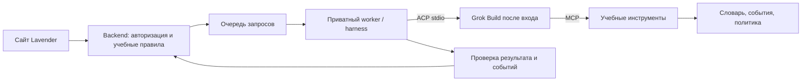

# Функциональность: ИИ-преподаватель, задания и собственная библиотека

Уточнение плана по запросу пользователя: **ИИ — основа учебного сценария**, а не отдельная кнопка чата. Дизайн остаётся Lavender Club. Документ описывает будущую реализацию, а не уже подключённый сервис.

## 1. Кто принимает учебные решения

ИИ получает текущую цель, уровень, выбранные темы, очередь повторений, историю попыток, виды помощи, недавние предъявления и оставшееся время. По этим данным выбирает следующее задание из разрешённого набора, формирует естественный контекст и объясняет выбор короткой фразой: «Попробуем вспомнить без подсказки» или «Теперь употребим слово в другой ситуации».

Решения опираются на версионируемую педагогическую политику из [научной базы](../../knowledge-base/vocabulary-learning/README.md). Это не чтение всей подборки статей перед каждым ответом и не произвольное мнение модели. Внутренний журнал связывает выбор с источниками R001–R013, наблюдениями пользователя и версией правил. Статьи, помеченные как непроверенные или дубли, не становятся источником обязательной методики.

Разделение ответственности:

| Компонент | Решает |
|---|---|
| Планировщик FSRS | Когда вернуть конкретное значение в соответствующем режиме проверки по подтверждённым событиям |
| Педагогическая политика | Какие виды задач допустимы, когда нужна помощь, что считается самостоятельным ответом |
| ИИ-преподаватель | Какой подходящий тип практики выбрать сейчас, какую ситуацию предложить, как объяснить ошибку |
| Серверная проверка | Существуют ли выбранные ID, допустимо ли действие, корректна ли схема, не нарушены ли лимиты и правила |
| Пользователь | Подтверждение спорного распознавания, предпочтение темпа, пропуск/смена режима, завершение |

ИИ не изменяет проверенный словарь, не назначает бесконечный поток заданий и не объявляет слово окончательно выученным. Низкая уверенность оценивания ведёт к подтверждению, а не штрафу. При отказе или недоступности модели работает базовая очередь проверенных карточек; разговор можно отложить.

## 2. Каталог практик

| Тип | Когда применять | Что измерять | Научная опора |
|---|---|---|---|
| Знакомство: значение + аудио + пример | Новое значение, до первой проверки | Ознакомление, не самостоятельное владение | R007 |
| Воспроизведение по смыслу | Основной режим повторения | Самостоятельная английская форма, модальность, усилие | R002, R005 |
| Устная фраза по ситуации | Форма уже знакома, нужен переход к речи | Подходящее употребление и отсутствие опоры | R004, R007 |
| Восстановление после ошибки | Не вспомнил или перепутал значение | Исправление, затем новая попытка после других слов | R002, R005; конкретная последовательность — проектное решение |
| Уточнение различия значений | Повторяются borrow/lend или разные book | Правильно понятый смысл и направление действия | Инженерное применение точной обратной связи; не отдельный доказанный универсальный метод |
| ИИ-диалог по сценарию | Есть несколько доступных слов и можно говорить | Уместное самостоятельное применение в новой ситуации | R004 |
| Накопительное повторение | Старые темы нуждаются в возвращении | Сохранение разных ранее изученных значений | R006 |
| Отсроченная проверка | Наступил запланированный срок | Ответ до показа, дата, интервал, размер выборки | R001, R003, R010 |
| Личный пример/ассоциация | Пользователь хочет дополнительную опору | Помощь при знакомстве, без ложного самостоятельного успеха | R011; преимущество мнемоники не гарантировано |
| Контекст и направляемая заметка | Второй этап, текст/видео с правами использования | Форма, значение, свой пример, последующая попытка | R012, R013 |

Распознавание из вариантов может облегчать знакомство, но не заменяет продуктивный результат. Упражнение на орфографию не должно автоматически определять успех устной речи. Разные правильные формулировки не штрафуются за несовпадение с одной строкой-эталоном.

## 3. Пример адаптации

Пользователь понимает `borrow`, но не может назвать его. ИИ предлагает точную русскую ситуацию без английской формы. Если ответа нет, показывает значение, звук и пример, затем вставляет другие задания перед возвращением к слову. Новый ответ после помощи отмечается отдельно. Позднее разговор создаёт другую ситуацию, где это слово уместно. Если ИИ сам произнёс `borrow`, следующая реплика пользователя не считается полностью независимым извлечением. Следующая отсроченная проверка проводится до повторного показа.

Если пользователь правильно говорит `Can I use your charger for a moment?`, коммуникация успешна. Целевая форма `borrow` не воспроизведена; можно предложить отдельную тренировку, не называть всю фразу ошибочной.

## 4. Контракт решения ИИ

Сервер передаёт ограниченный набор допустимых entry ID и безопасный учебный контекст. Ответ модели валидируется по схеме: `task_type`, `entry_ids`, `skill_target`, `prompt`, `answer_visibility`, `support_level`, `reason_code`, `evidence_refs`, `estimated_duration`, `policy_version`.

Проверки до показа: существующие ID и значение; задача входит в allowlist; источник исследования существует; английский ответ/IPA/пример не утекли в самостоятельную проверку; объём подходит выбранной сессии; отсутствует циклическое повторение одной и той же задачи. `evidence_refs` модели сверяются с разрешённой картой правил, а не считаются достоверными по факту генерации.

Оценка ответа содержит отдельно: `communicative_success`, `target_form_used`, `sense_correct`, `assistance`, `recent_exposure`, `transcript_uncertain`, `feedback`, `needs_confirmation`. Исходный и исправленный transcript различимы. Состояние памяти меняется только после нормализации результата по правилам сервера. Любой повтор запроса идемпотентен.

Для надёжности сначала применяется небольшой фиксированный каталог практик. Возможность модели создавать совершенно новые методики или писать исполняемый код упражнений в первой версии не нужна. Пользователь может нажать «Почему это задание?» и получить короткое объяснение с доступной ссылкой на методику, без раскрытия внутренних рассуждений модели.

## 5. Импорт целой библиотеки

Первая версия принимает **JSON библиотеки, CSV и ZIP-пакет проверенного формата с JSON-файлами**, а также ручной ввод. Наш готовый `vocabulary.json` поддерживается напрямую; ZIP может содержать `vocabulary.json`, `topics.json`, `sources.json`. Исходный ZIP с учебными фотографиями — иной тип входа, требующий OCR и проверки; это отдельный последующий режим, не молчаливое обещание текущего импорта.

Поток: файл → определение формата → сопоставление полей → проверка → предпросмотр новых/совпадающих/спорных записей → подтверждение → импорт с отчётом. Подтверждение относится к конкретным данным, показанным в предпросмотре. Загрузка сама по себе не заменяет прежний словарь и не сбрасывает прогресс.

| Поле | Правило |
|---|---|
| English / english | Обязательное слово или выражение |
| Translation / translation_ru | Обязательное значение для подтверждённой карточки; ИИ может предложить черновик |
| Topic / topics | Одна или несколько тем; если нет — «Без темы», можно назначить позже |
| IPA / ipa | Необязательно; язык/вариант произношения указан отдельно |
| ID / source ID | Сохранить как внешний ID в пространстве конкретной библиотеки, чтобы разные загрузки не перезаписали чужие записи |
| Sources / locator | Сохранить происхождение; при неизвестном источнике не выдумывать его |

CSV поддерживает UTF-8/BOM, кавычки, переносы и выбор разделителя; пример шаблона предоставляется в интерфейсе. Многозначность не схлопывается: одинаковое английское написание и разные переводы могут быть разными смыслами. Нормализация пробелов/регистра помогает поиску совпадений, но не заменяет решение о смысле. Повторная загрузка выявляется по hash и external IDs; конфликт предлагает оставить, добавить значение или обновить после просмотра.

Обновление существенного значения создаёт новую версию и пересмотр учебного состояния, а не переносит прежний успех на другое слово. Частичный импорт разрешается только с явным перечнем исключённых строк. После завершения — числа принятых/пропущенных/спорных и скачиваемый отчёт. Пользователь может отменить созданный импорт, не удаляя существовавшие ранее записи.

Проектные начальные ограничения: файл до 20 MB, до 10 000 записей; ZIP до 3 разрешённых JSON-файлов и 30 MB распакованных данных. Ограничения настраиваемы после пилота и видны до загрузки. Проверять путь каждого ZIP-entry, размер после распаковки, расширение и структуру; ничего не исполнять. Ячейки/текст/источники пользователя трактовать как данные, не как инструкции ИИ. SQLite-импорт и OCR произвольных документов — последующий этап с собственным контрактом.

## 6. Ручное добавление

Из раздела «Слова»: **Добавить слово** → английское выражение, конкретное значение, тема, необязательные IPA/пример → проверка совпадений → сохранить. Можно вставить несколько строк и получить тот же предпросмотр, что у CSV.

ИИ помогает предложить перевод, IPA, пример и тему, но предложения остаются черновиками до подтверждения. У слова есть происхождение «Добавлено вручную», дата и история изменений. Пользовательская запись хранится отдельно от общей проверенной библиотеки; при совпадении можно добавить существующее значение в личную практику.

После добавления пользователь выбирает «Начать знакомство» или «Добавить на потом». Новое слово не считается уже изученным. При наличии неполного перевода запись сохраняется как черновик и не попадает в автоматическую очередь.

## 7. Grok Build: harness + ACP + MCP

Пользователь уточнил официальный инструмент: `irm https://x.ai/cli/install.ps1 | iex`. Установщик прочитан как текст; он не запускался в Linux-среде. [Grok Build Overview](https://docs.x.ai/build/overview) подтверждает интерактивный вход через браузер, headless-запуск и интеграцию через ACP. [Headless & Scripting](https://docs.x.ai/build/cli/headless-scripting) документирует `grok -p`, `--output-format json`, `--output-format streaming-json` и `grok agent stdio`.

В официальном ACP-примере есть `authenticate` с `cached_token` после локального входа или `xai.api_key`, если используется API-ключ. Это делает выбранную пользователем интеграцию технически обоснованной. Доступные методы нужно читать из `initialize.authMethods`, а не жёстко считать любой токен бессрочным. Фактический вход, доступ аккаунта, квоты и задержки ещё не проверены.

**Основной план — harness через ACP.** Harness — наш серверный контроллер процесса: запускает CLI, управляет сессиями, запросами, таймаутами, отменой, потоковыми ответами и валидацией заданий. ACP соединяет контроллер с агентом. MCP предоставляет агенту ограниченные учебные инструменты. Это дополняющие части, а не выбор «harness или MCP».

### Личная версия и размещение

Сначала один пользователь и worker на компьютере, где выполнен вход Grok. Он подключается к backend аутентифицированным исходящим соединением или забирает ограниченные задания из очереди; не открываем публичный shell/CLI endpoint. Пока компьютер выключен, ИИ недоступен, но словарь и обычные повторения работают. На сайте видны состояния worker: готов, занят, офлайн, нужно войти, исчерпан лимит.

Для постоянно доступного сервиса понадобится отдельный долгоживущий worker на сервере с поддержанной авторизацией и проверенными условиями аккаунта. Serverless-маршрут Next.js не используется как постоянный ACP-процесс. Сохранённый вход на Windows не переносится в облако автоматически. Одна личная подписка не объявляется лицензией на обслуживание произвольного числа пользователей; это отдельная проверка перед публичным запуском.

### Контракт worker

`initialize` → выбор поддержанного auth method → `authenticate` → `session/new` → `session/prompt`; текст приходит событиями `session/update`, а результат prompt содержит сведения о завершении. Схемы сверяются с закреплённой версией CLI/ACP. Отдельная сессия на учебный диалог; не использовать глобальный `--continue` для разных пользователей. JSON внешнего CLI-протокола не гарантирует корректность вложенного учебного JSON: нужен отдельный серверный валидатор.

Worker ограничивает очередь, параллелизм, время и размер ответа; поддерживает отмену, переподключение и истечение входа. Для воспроизводимости закрепляется версия CLI и управляются обновления. `--always-approve` не является настройкой учебного runtime. Ненужные доступы к файловой системе, shell и сторонним MCP запрещаются политикой/изоляцией, а не только текстом промпта. CLI запускается аргументами процесса без shell-интерполяции пользовательских строк.

### Учебный MCP

[Официальная документация MCP](https://docs.x.ai/build/features/mcp-servers) подтверждает local stdio и remote HTTP-серверы. Проектируем узкие инструменты: `get_due_items`, `get_word_senses`, `get_attempt_summary`, `get_learning_policy`, `propose_activity`, `submit_feedback_draft`. Пользователь определяется серверной сессией, не переданным моделью произвольным ID.

ИИ предлагает деятельность и оценку; запись подтверждённого review-event и изменение FSRS выполняет доверенная серверная логика. MCP не выдаёт произвольный SQL, доступ к shell или возможность редактировать исходные переводы. Импортированные тексты считаются учебными данными, не командами агенту. Совместимость автоматически найденных MCP из окружения проверяется через `grok inspect`; рабочее окружение harness отделяется от среды разработки.

### Подписка и голос

[Usage limits](https://docs.x.ai/x-subscription/usage-limits) описывает лимиты по месту/eligible surfaces и дополнительное использование. Точный тариф пользователя не установлен; наличие подписки не означает безлимитную работу всех API. На пилоте проверяются реальное списание лимитов, непрерывность входа и допустимый личный режим.

Голос — отдельный адаптер. [Voice Overview](https://docs.x.ai/developers/model-capabilities/audio/voice) описывает speech-to-speech через WebSockets, временные токены и отдельные STT/TTS. В документации CLI/ACP не подтверждён такой же аудиопоток по подписке Build. Сначала проверяем доступ пользователя к голосовому варианту. Если голоса через выбранный канал нет, согласуется поддержанный speech-провайдер/доступ; распознавание и озвучка оборачивают текстового преподавателя. Отдельную оплату нельзя включать молча. До решения работает текстовый учебный цикл.

Предыдущее предложение OpenAI в STACK.md — исторический вариант, не текущий выбор пользователя. Нужны `TutorProvider = GrokBuildACP` и независимый `VoiceProvider`. Пароли/токены не пересылаются в чат и не коммитятся. Учесть, что CLI сохраняет локальные сессии: политика удаления transcript распространяется и на worker, а не только на PostgreSQL.

### Проверка до реализации основного приложения

Вход пользователя → `grok inspect` и версия → один безопасный headless-ответ → ACP с сохранённой авторизацией → учебный MCP только чтения → валидируемое задание → таймаут/отмена/повтор запроса → отключённый worker → лимит и повторный вход → отдельная проверка голоса. Этот этап должен подтвердить интеграцию, прежде чем обещать постоянную онлайн-доступность.

## 8. Дополнения к экранам Lavender

- «Слова»: рядом **Загрузить библиотеку** и **Добавить слово**; первый вход предлагает загрузить свою базу или использовать подготовленную.
- Импорт: зона файла, пример формата, mapping, таблица предпросмотра, конфликты, итог; состояние обработки и возможность отмены.
- Ручной ввод: постоянные labels, нужное значение, темы, помощь ИИ с пометкой «Предложение», предупреждение о совпадении.
- Занятие: один текущий шаг, причина выбора по запросу, помощь, смена режима и завершение. ИИ не заставляет пользователя выбирать среди десятков упражнений.
- Итог: что удалось самостоятельно, что с помощью, что вернётся позже. Не выдавать непрозрачный «AI score» за научный показатель.

## 9. Проверки перед реализацией и приёмкой

Импортировать исходную библиотеку целиком и повторно; проверить ручное слово, новый смысл знакомого написания, конфликт внешних ID, ошибочную строку, пустой перевод, отмену и сохранность прогресса. Проверить, что загрузка и AI-предложения не меняют общую базу без редакторского действия.

ИИ проверяется на наборе сценариев: не вспомнил, правильно с трудом, ответ после подсказки, правильный синоним, неверное значение, сомнительное распознавание, недавний просмотр и произнесённое ИИ целевое слово. Ложное признание самостоятельного успеха — отдельная ошибка качества. Политику версионировать и сравнивать изменения на этом наборе до выпуска.

Измерять отсроченное воспроизведение, уместное применение, долю помощи, количество проверенных значений и затраты времени. Адаптивный выбор ИИ — проектная гипотеза, которую нужно проверять на пилоте; сами статьи не доказывают эффективность любой LLM-оркестрации.
