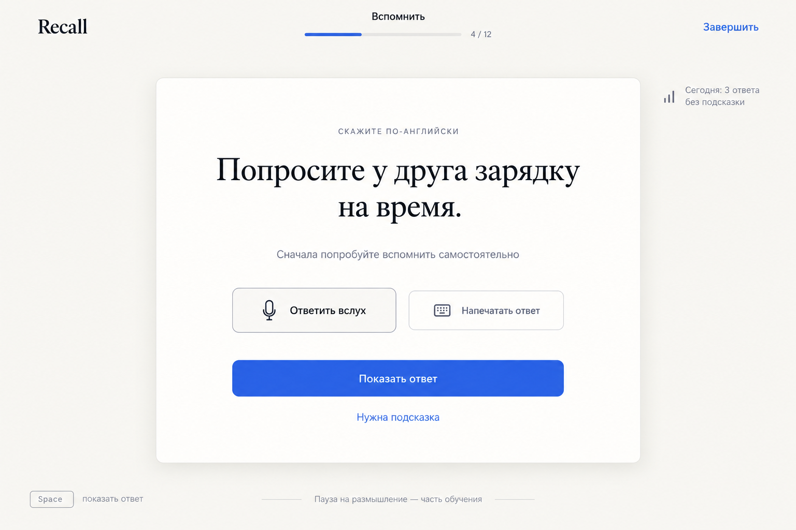
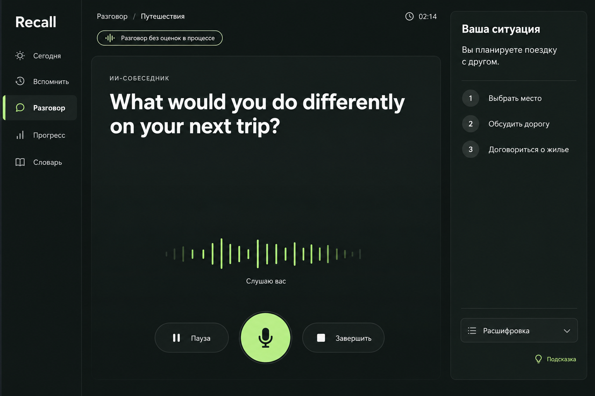
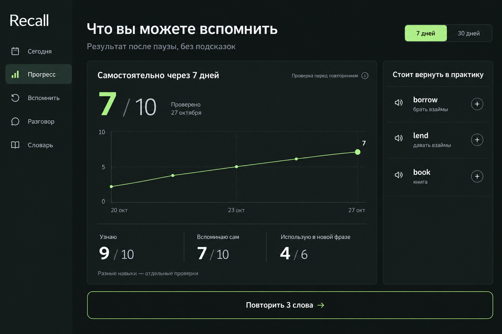
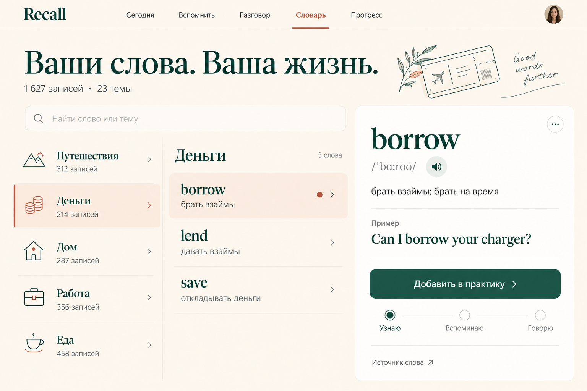

# Пять визуальных референсов Recall

Созданы 27 октября 2026 года после анализа источников и фиксации [стека](../STACK.md). Это оригинальные сгенерированные изображения интерфейсов. Три направления: **Paper**, **Signal**, **Fieldnotes**. Состав экранов — в [SCREENS.md](../SCREENS.md), токены — в [DESIGN_SYSTEMS.md](../DESIGN_SYSTEMS.md).

Данные и показатели иллюстративны. Текст, IPA, числа и подписи осей в генерациях могут отличаться от точной спецификации; они не заменяют проверенную словарную запись или реальные результаты. Порядок пунктов навигации при реализации берётся из спецификации и остаётся единым. Рабочие состояния и адаптация проверяются отдельно в [HTML-макете](../preview/index.html).

## 01. Paper — Сегодня

Светлый рабочий стол: одно следующее действие, линейный план занятия и отдельный результат отсроченной проверки. Стиль рекомендован как основной.

## 02. Paper — Самостоятельное вспоминание

Ситуация на русском, английский ответ скрыт. Явное раскрытие после попытки, голосовая и письменная альтернативы.

## 03. Signal — Разговор с ИИ

Тёмная голосовая студия: текущая реплика, статус микрофона, пауза и завершение. Ситуация помогает начать разговор, английские целевые слова не перечислены заранее.

## 04. Signal — Прогресс

Самостоятельное воспроизведение спустя время, явный знаменатель и отдельное применение в новой фразе. Это разные показатели, а не общий балл «выучено».

## 05. Fieldnotes — Словарь и темы

Тёплая библиотека: жизненные темы, английское слово, значение, аудио, пример и происхождение. В библиотеке ответ открыт; при переходе в проверку он скрывается.

## Для дальнейшей работы

[prompts.json](prompts.json) сохраняет исходные задания генератору. Изображения задают художественное направление; компоненты, состояния, реальные тексты и адаптация реализуются отдельно. [HTML-макет](../preview/index.html) позволяет сравнивать три темы на одинаковых пяти экранах; рядом сохранены снимки Chromium для desktop и mobile.
