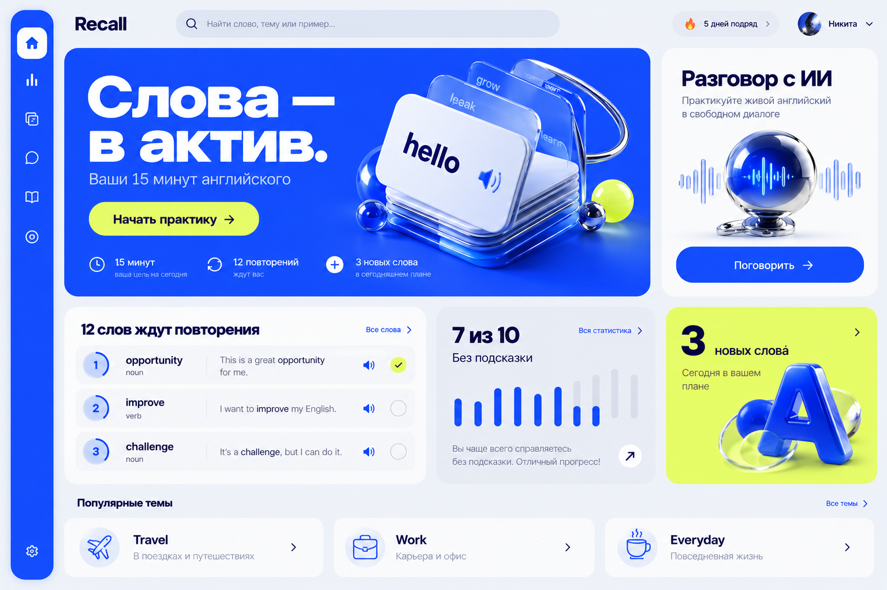
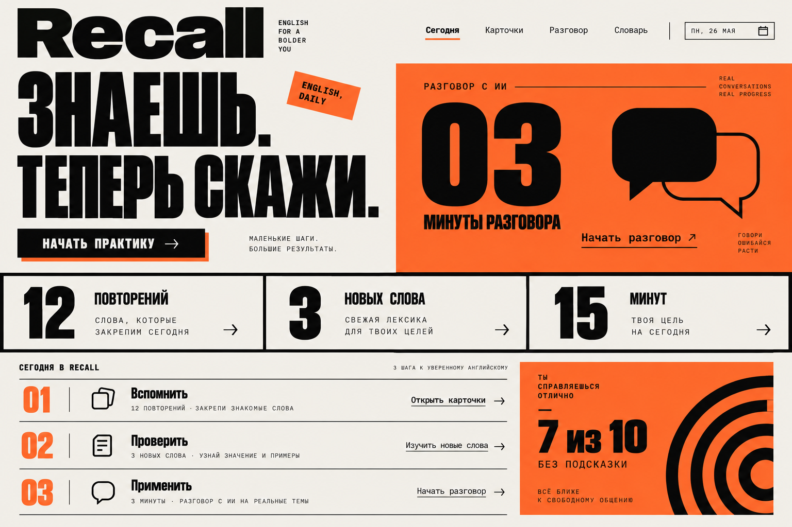
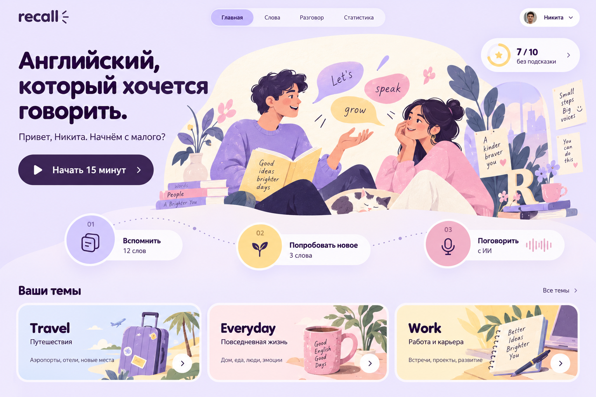
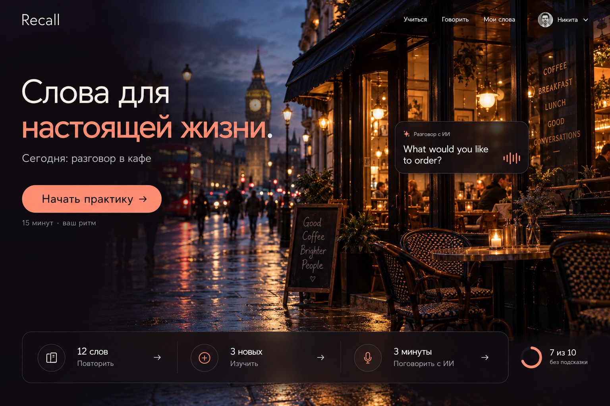
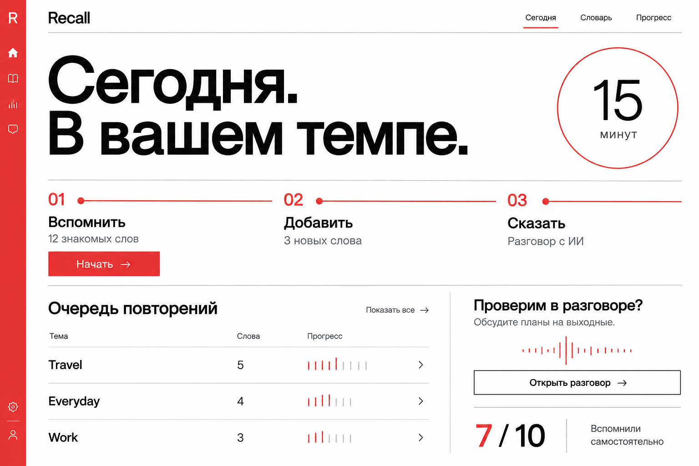

# Пять новых вариантов главного экрана

Пять разных визуальных направлений для одного сайта Recall. Новая серия от 27 октября 2026 года.

Нажмите на название, чтобы открыть отдельное изображение.

## [Electric Cobalt — синий объёмный интерфейс](01-electric-cobalt.png)

## [Orange Press — оранжевая графичная композиция](02-orange-press.png)

## [Lavender Club — мягкий дизайн с иллюстрациями](03-lavender-club.png)

## [After Hours — тёмный вариант с фотографией](04-after-hours.png)

## [Swiss Index — строгий бело-красный интерфейс](05-swiss-index.png)

